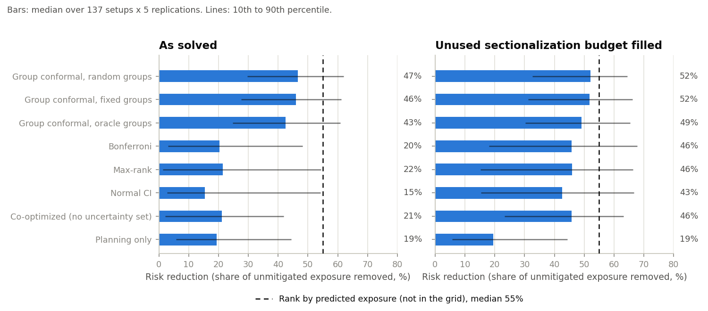
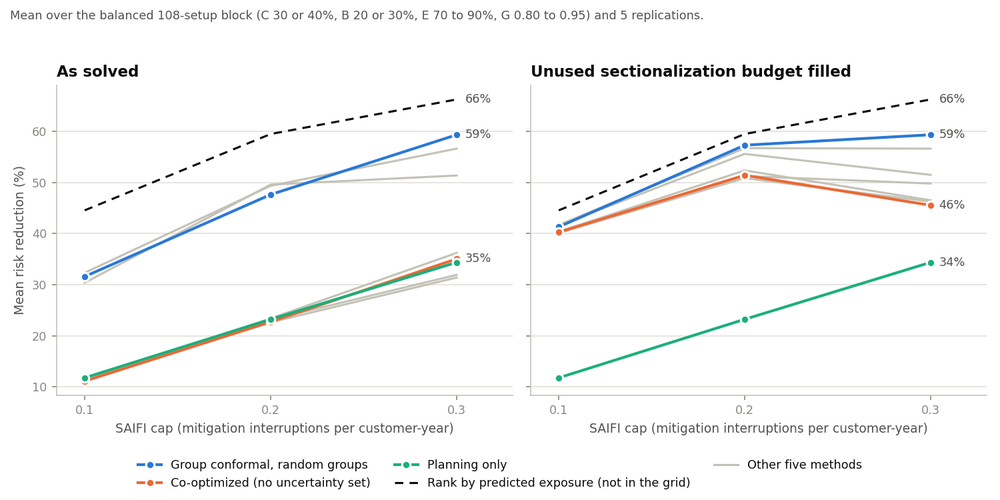
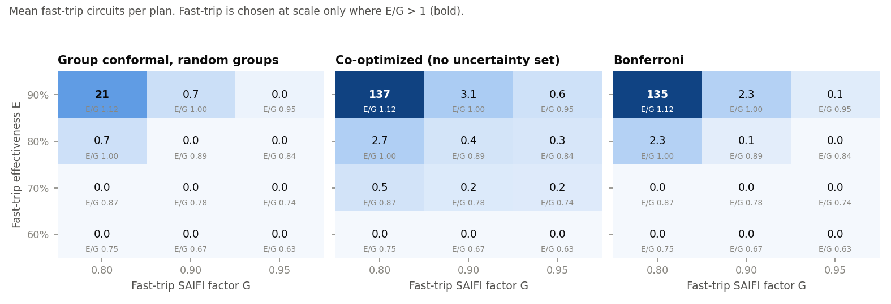
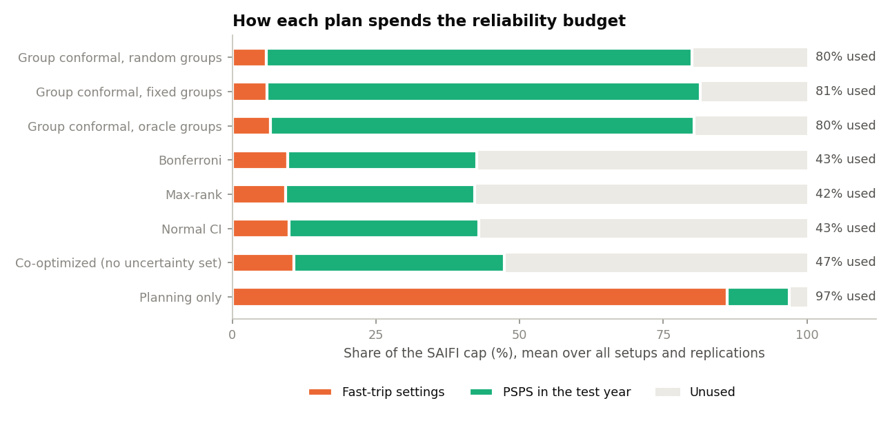

# Sectionalization and fast-trip planning study: findings

October 2026. What the optimization grid behind
[arXiv:2604.01232](https://arxiv.org/abs/2604.01232) shows once every run is
read, re-checked, and compared on the same draws. Method, data contract, and
run steps: [README.md](README.md). Every number here is in `results.json`.

## Summary

- **As solved, the proposed plan (group conformal, random groups) wins almost
  everywhere.** Its median risk reduction is 46.6%, against 21.1% for
  co-optimized and 19.5% for planning only. It leaves less exposure than
  co-optimized in 99.0% of paired draws and in every setup on average.
- **The SAIFI cap is the only knob that moves results much.** Raising it from
  0.1 to 0.3 lifts the proposed plan from 31.6% to 59.4% risk reduction. The
  sectionalization budget, the fast-trip budget, and the fast-trip assumptions
  each move it by 2.4 points or less.
- **About 80% of the lead over co-optimized comes from how many circuits a plan
  sectionalizes, not from the uncertainty set.** The optimal plans are
  indifferent to sectionalized circuits they do not plan to shut off, so they
  often leave budget unused. Filling that budget, which is free in the model,
  shrinks the proposed plan's median gain over co-optimized from 32.1% to 6.5%.
- **A simple ranking plan the grid did not run beats every optimized plan.**
  Sectionalizing the circuits with the highest predicted population-weighted
  exposure, with no fast-trip, reaches 54.9% median risk reduction. The
  proposed plan beats it in 10.5% of paired draws as solved, and 15.9% with its
  budget filled.
- **Fast-trip is chosen only where it removes more exposure per unit of SAIFI
  than a shutoff** (effectiveness over SAIFI factor, E/G, above 1). In this grid
  that happens only at E = 0.9 and G = 0.8. There, the deterministic plans put
  up to 99% of the SAIFI cap into fast-trip and gain little.

These are model outcomes on semi-synthetic ignitions, not recorded events. See
[Caveats](#caveats).

## Data and checks

- **Runs.** 138 setups were run; 137 are complete (5 replications x 8 methods);
  one was interrupted and is left out. That is 5,480 runs over 803 PG&E
  circuits in HFTD Tier 2 or 3.
- **Realized-cost audit.** Every run's test-year PSPS response was re-solved
  with HiGHS and matched the grid's `eval_cost` to within 1.0e-4 relative,
  which is Gurobi's default gap. HiGHS was never worse and was slightly better
  in 1,004 runs.
- **Shutoff counts are not unique.** Optimal shutoff sets can differ by up to
  33 circuits at the same exposure (906 runs differ from the grid's count).
  This memo compares exposure and SAIFI shares, not shutoff counts.
- **Pairing.** Every comparison is paired: two methods on the same setup and
  the same replication, which is the same synthetic training, calibration, and
  test draw. The 5 replications are shared by all setups, so "share of draws"
  counts 685 pairs that are not independent; consistency across the 5
  replications is reported where it matters.

## 1. As solved, the proposed plan wins nearly everywhere



| Method | Median risk reduction | Median gain over co-optimized | Lower exposure than co-optimized | Best of the 8 |
|---|---|---|---|---|
| Group conformal, random groups | 46.6% | 32.1% | 99.0% | 58.0% |
| Group conformal, fixed groups | 45.9% | 27.9% | | 23.6% |
| Group conformal, oracle groups | 42.5% | 24.7% | | 16.9% |
| Bonferroni | 20.3% | 3.0% | | 0.1% |
| Max-rank | 21.5% | -1.1% | | 1.3% |
| Normal CI | 15.5% | 0.9% | | 0.0% |
| Co-optimized (no uncertainty set) | 21.1% | | | 0.0% |
| Planning only | 19.5% | 0.0% | | 0.0% |

"Risk reduction" is the share of the unmitigated, population-weighted ignition
exposure a plan removes in the test year. "Gain over B" is the share of B's
remaining exposure the plan removes.

- **Consistent across draws.** The proposed plan's median gain over
  co-optimized is 33%, 30%, 39%, 33%, and 20% in the five replications. Over
  planning only it is 31% (median), better in 99.0% of draws.
- **The group-sum bound is what makes the robust plans work.** Normal CI has
  per-circuit intervals about as narrow as the proposed method's (mean width
  7.1 vs 7.5 ignitions) but no group bounds, and it does no better than
  co-optimized. Without group bounds the worst case puts every circuit at its
  upper bound at once.
- **The three grouping choices are close.** Random groups beat fixed groups in
  66% of draws (median gain 3.7%), but fixed groups win by 27% (median) in
  replication 4.

## 2. The SAIFI cap is the only knob that moves results much



On the balanced 108-setup block, the range of the proposed plan's mean risk
reduction across each parameter's levels is:

| Parameter | Levels | Range of mean risk reduction |
|---|---|---|
| SAIFI cap W | 0.1, 0.2, 0.3 | 27.8 points (31.6% to 59.4%) |
| Fast-trip SAIFI factor G | 0.80, 0.90, 0.95 | 2.4 points |
| Fast-trip effectiveness E | 0.7, 0.8, 0.9 | 2.4 points |
| Sectionalization budget C | 0.3, 0.4 | 2.1 points |
| Fast-trip budget B | 0.2, 0.3 | 0.1 points |

- **Every method follows the cap.** Co-optimized goes from 11.1% to 35.1% and
  planning only from 11.8% to 34.4%.
- **The proposed plan's advantage grows with the cap.** Its mean gain over
  co-optimized is 22.5%, 30.6%, and 36.6% at W = 0.1, 0.2, and 0.3.
- **Budgets barely matter for the optimizing methods.** Going from C = 0.3 to
  0.4 adds 2.1 points for the proposed plan and about 0 for co-optimized and
  the per-circuit robust plans, which do not use the extra budget.
- **More fast-trip budget hurts planning only.** Its risk reduction falls 1.2
  points (mean) from B = 0.2 to 0.3, because the extra fast-trip settings use
  SAIFI cap that test-year PSPS could have used.

## 3. Most of the lead comes from sectionalizing more circuits

Sectionalization has no cost in the model beyond its budget, and a plan's
objective only rewards circuits it plans to shut off. The optimal plans are
therefore indifferent to extra sectionalized circuits and often leave budget
unused. In the evaluation, though, the test-year PSPS response can only shut
off sectionalized circuits, so every unused slot is a lost option.

| Method | Runs with unused budget | Median circuits unused | Median exposure cut by filling |
|---|---|---|---|
| Group conformal, random groups | 64% | 84 | 7.4% |
| Co-optimized | 86% | 107 | 29.8% |
| Bonferroni | 90% | 101 | 31.9% |
| Max-rank | 89% | 112 | 32.3% |
| Normal CI | 89% | 103 | 31.7% |

Filling completes the budget by predicted exposure, which is information every
plan already has, then re-solves the test-year PSPS response. It can never
raise exposure.

- **With every plan filled, the field compresses.** The proposed plan's median
  risk reduction rises to 52.2% and co-optimized's to 45.8%.
- **The proposed plan keeps a small edge.** Its median gain over co-optimized
  drops from 32.1% to 6.5%, which keeps 20% of its original lead. It still has
  lower exposure in 72.7% of draws, and in 87.6% of setups on average.
- **The remaining edge depends on the cap.** It is about 0 at W = 0.1, 7.7% at
  W = 0.2, and 21.9% at W = 0.3 (mean gain, balanced block). It is also larger
  where fast-trip looks attractive (15.3% at E = 0.9), because there the
  deterministic plans over-commit to fast-trip (section 5).

The workspace's **As solved / Budget filled** switch shows both variants for
every setup.

## 4. A simple ranking plan beats every optimized plan

The grid has no plan that ignores the optimization altogether. A simple one is
to sectionalize the C x n circuits with the highest predicted
population-weighted exposure (`p_i * mu_i`), use no fast-trip, and let the
test-year PSPS response act as it does for every other plan.

| Plan | Median risk reduction | Mean, W = 0.1 / 0.2 / 0.3 |
|---|---|---|
| Rank by predicted exposure `p_i * mu_i` | 54.9% | 43.4% / 56.6% / 64.5% |
| Rank by predicted ignition rate `mu_i` | 31.9% | 29.4% / 33.5% / 35.4% |
| Proposed plan, as solved | 46.6% | |
| Proposed plan, budget filled | 52.2% | |

- **The ranking plan is hard to beat.** The proposed plan leaves less exposure
  than it in 10.5% of paired draws as solved (median gain -14.9%), and in 15.9%
  with its budget filled (median -4.0%). That is the best of the grid's
  methods; even with budgets filled, none beats the ranking plan in more than
  16% of draws.
- **Why it works.** The evaluation lets PSPS respond to the ignitions that
  actually occur. Under that rule most plans leave much of the SAIFI cap unused
  (co-optimized uses 37% of it in the test year), so what limits the response is
  which circuits are sectionalized. Covering the circuits with the most expected
  population-weighted exposure is then close to the right first-stage choice,
  and the ranking plan uses 87% of the cap.
- **Population matters.** Ranking by ignition rate alone reaches only 31.9%.
  Co-optimization effectively ranks by rate, because a shutoff's SAIFI cost
  scales with the same population as its exposure removed, so population
  cancels in its planned knapsack.
- **What it does not show.** It does not show that robust planning is useless.
  It shows that this evaluation rewards coverage, and that the grid has no
  baseline built to exploit that.

## 5. Fast-trip is chosen only where it beats a shutoff per unit of SAIFI



A fast-trip setting removes a share E of a circuit's exposure for G units of
SAIFI. A shutoff removes all of it for delta = 1 unit, but only where and when
it is used. The plans choose fast-trip at scale only where E/G > 1:

| E / G | Co-optimized fast-trip circuits | Proposed plan fast-trip circuits |
|---|---|---|
| 1.125 (E 0.9, G 0.8) | 137 | 21 |
| 1.00 (E 0.9, G 0.9 or E 0.8, G 0.8) | 2.7 to 3.1 | 0.7 |
| below 1 | 0.6 or fewer | 0.01 or fewer |

- **The fast-trip budget is not binding** for any optimizing method, which is
  why B has no effect (section 2).
- **Deterministic plans over-commit.** At E/G = 1.125, co-optimized spends
  93% to 99% of the SAIFI cap on fast-trip. Its realized risk reduction there
  is 12.1% at W = 0.1, against 25.1% for the proposed plan. Filling its
  sectionalization budget does not help, because no cap is left for shutoffs.
- **The robust plan hedges.** Its worst case can move ignitions away from
  protected circuits, so it buys far less fast-trip.

## 6. Where the reliability budget goes



| Method | Fast-trip | PSPS in the test year | Unused |
|---|---|---|---|
| Group conformal, random groups | 6% | 74% | 20% |
| Co-optimized | 11% | 37% | 53% |
| Bonferroni | 10% | 33% | 57% |
| Planning only | 86% | 11% | 3% |

Shares are means over all setups and replications. The group conformal plans
sectionalize enough circuits for the test-year response to use most of the cap.
Co-optimized and the per-circuit robust plans plan to use almost all of it (about
90%) but use about a third, because the ignitions land on circuits they did not
sectionalize. Planning only spends the cap on fast-trip before any ignition
occurs.

## 7. Plans' own estimates against what happens

Median ratio of the exposure a plan expected to the exposure realized:

| Method | Planned / realized |
|---|---|
| Co-optimized (predicted mean) | 0.39 |
| Group conformal, random groups (worst case) | 3.7 |
| Group conformal, fixed groups | 5.1 |
| Group conformal, oracle groups | 6.4 |
| Normal CI | 9.1 |
| Max-rank | 10.4 |
| Bonferroni | 18.4 |

The deterministic plan is overconfident by about 2.6 times. The robust plans
are pessimistic by design, and the proposed plan is the least pessimistic. Its
set covered the test outcome in 4 of 5 replications (Bonferroni 5 of 5; the
others 3 of 5). Five replications cannot confirm a 40% miscoverage target.

## 8. Stability, geography, and computation

- **Stability across draws.** The proposed plan's sectionalized set changes
  little between replications: the mean overlap (Jaccard) is 0.72, the same as
  co-optimized's 0.71. The per-circuit robust plans move a lot (0.15 to 0.22),
  so their recommendations would change from year to year.
- **Where it sectionalizes.** 71 circuits are sectionalized in at least 90% of
  the proposed plan's runs, and 140 are never sectionalized. The core 71 serve
  31% of the study population. They are 32% Tier 3, against 39% of all study
  circuits, because population weighting favors populous circuits. San Jose
  division has the most core circuits (16), then Central Coast and Mission (8
  each).
- **Computation.** The group conformal solves hit the 240-second limit in 28%
  (random), 37% (fixed), and 34% (oracle) of runs. For the proposed plan the
  time-outs concentrate at W = 0.3 (69% of runs, against about 10% at lower
  caps). A timed-out run has the same median gain over co-optimized (32.2%
  against 32.1%), but a worse tail: its worst draw is -37% against +2%.

## What this suggests for the paper and the next grid

1. **Add the ranking baseline** (rank by predicted population-weighted
   exposure, no fast-trip), and report results both as solved and with unused
   sectionalization budget filled. Together they separate the value of the
   uncertainty set from sectionalization coverage.
2. **Break the tie in sectionalization.** Add a small secondary reward for
   sectionalizing high predicted-exposure circuits, or a real cost per
   sectionalized circuit, so solutions stop depending on which optimum the
   solver returns.
3. **Revisit the evaluation's PSPS rule.** Shutoffs chosen with the realized
   ignitions in hand reward coverage. Shutoffs decided on forecasts, with the
   realized ignitions used only for scoring, would test the robust plans where
   they should matter.
4. **Extend the fast-trip SAIFI factor below 0.8.** At G between 0.8 and 0.95
   fast-trip almost never pays. If an activation interrupts only the customers
   downstream of the device, G would be lower; the platform's PG&E EPSS outage
   records could estimate the affected share per activation.
5. **Use more replications** before claiming coverage or comparing grouping
   rules. Five shared draws decide several of the close comparisons above.
6. **Give W = 0.3 more solve time** or warm starts, where most time-outs occur.
7. **Decide whether population is the right consequence weight.** It pulls the
   plan toward populous Tier 2 circuits; HFTD tier or spread potential would
   change the core set.

## Caveats

- **Simulated ignitions.** Test-year ignitions are simulated from a fitted
  weather and ignition model (PCA plus VAR weather, Poisson ignitions), not
  observed. Exposure is population-weighted ignitions; population near a
  circuit stands in for consequence.
- **Shared draws.** The 5 replications are shared by every setup, so
  grid-wide shares are not independent samples. Close comparisons (between the
  group conformal variants, or after filling) can turn on one replication.
- **Heuristic comparators.** Budget fill and the ranking plans are simple
  heuristics added here. They are scored with the same PSPS response as the
  grid's methods, but they were not part of the study design.
- **Not optimal everywhere.** Timed-out group conformal runs report their best
  plan at 240 seconds, which may not be optimal.
- **One setup missing.** `C20-B10-W30-E70-G90` is missing from every table.

## Reproduce

```sh
PYTHONPATH=. python -m analysis.sectionalization.ingest --grid-dir ... --prediction-dir ... --circuit-metadata ...
PYTHONPATH=. python -m analysis.sectionalization.analyze
PYTHONPATH=. python -m analysis.sectionalization.figures
```

See [README.md](README.md) for the arguments.
